   
      
 

👨‍💻 About Me

I'm a Mobile App & Web Developer who builds fast, beautiful and scalable products — from pixel-perfect UI to production-ready apps. I work hand-in-hand with agentic AI tools to plan, build, test and ship faster without compromising quality.

💼 Building professionally since 2024 — websites, admin dashboards and mobile apps for real clients
🌍 Delivered projects across e-commerce, delivery, travel, booking, wellness and SaaS platforms
🤝 Comfortable working with teams, backend developers and designers (Figma to code)

📌 Note: This is my new GitHub home. Much of my earlier work since 2024 was built in client-owned or private repositories, so you'll see my latest projects here.

ts
const moazzem = {
  role: ["Mobile App Developer", "Web Developer"],
  experience: "Since 2024",
  mobile: ["React Native", "Expo", "iOS & Android"],
  web: ["Next.js", "React", "TypeScript", "Tailwind CSS"],
  backend: ["Node.js", "Express", "MongoDB", "Firebase", "REST & Realtime APIs"],
  ai: ["Claude Code", "Cursor", "GitHub Copilot", "ChatGPT", "MCP", "Agentic Workflows"],
  focus: ["Clean UI/UX", "Performance", "Scalable Architecture"],
  currentlyBuilding: "Cross-platform apps & admin dashboards",
};
⚡ What I Do
<table> <tr> <td width="50%" valign="top">
📱 Mobile App Development
Cross-platform apps for iOS & Android with React Native & Expo
Smooth animations, gestures & native-feel UI
Push notifications, maps, payments & camera integration
Offline storage, auth & secure API integration
Play Store & App Store build and deployment
AI-assisted development for faster delivery
</td> <td width="50%" valign="top">
🌐 Web Development
Modern websites & web apps with Next.js & React
Powerful admin, vendor & agent dashboards
Pixel-perfect Figma to code, fully responsive
SEO-friendly, fast & accessible pages
REST APIs, real-time features (Socket.IO) & auth
</td> </tr> </table>
🤖 AI-Powered Development
<table> <tr> <td valign="top">

I'm comfortable working with agentic AI across the whole development cycle — not just autocomplete:

🧠 Planning & architecture — turning Figma designs and requirements into clear build plans
⚡ Rapid building — scaffolding screens, APIs, dashboards and full features with AI agents
🔍 Code review, debugging & refactoring with AI assistance
🧪 Writing tests & documentation automatically
🔗 MCP & tool integrations — connecting AI to GitHub, Figma, browsers and APIs
✍️ Prompt engineering for reliable, production-quality output
</td> </tr> </table> 
      

Agentic Workflows AI Code Review Prompt Engineering Figma to Code with AI AI Testing & Docs MCP Servers

🛠️ Tech Stack

 <table> <tr> <td align="center" width="50%" valign="top">  
📱 Mobile

  
 
 &nbsp; &nbsp; &nbsp;  

React Navigation · Gesture Handler · Push Notifications · In-App Payments

  

</td> <td align="center" width="50%" valign="top">  
🌐 Frontend

      
 
 &nbsp; &nbsp;  

Radix UI · Ant Design · React Hook Form · Zod · RTK Query · Recharts · Chart.js

  

</td> </tr> <tr> <td align="center" width="50%" valign="top">  
⚙️ Backend & Database

      
 
 &nbsp; &nbsp;  

REST API · Realtime APIs

  

</td> <td align="center" width="50%" valign="top">  
🧰 Tools & Deployment

      
 
 &nbsp; &nbsp;  

CI/CD · Store Deployment · Figma to Code

  

</td> </tr> </table>  

      

📈 GitHub Stats

   
 
  

🤝 Let's Work Together

 Have an app or website idea? I'd love to help bring it to life. 🚀 
 
    

